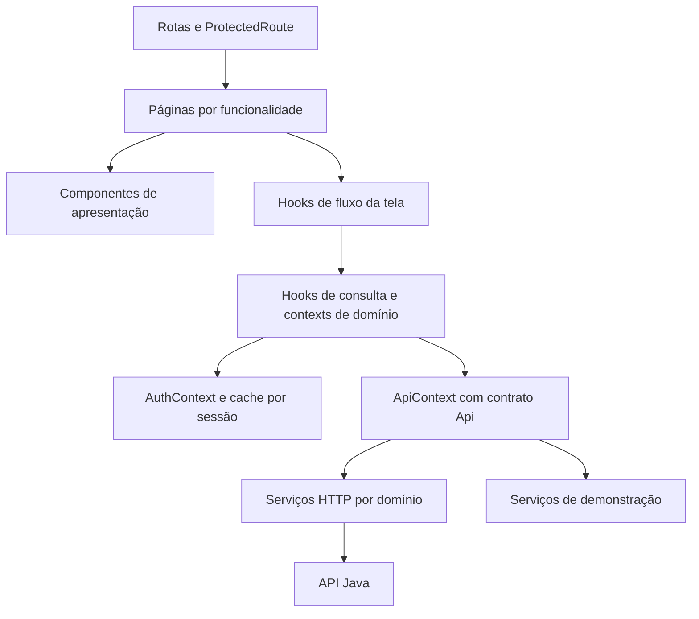

# Arquitetura do front-end

O projeto separa apresentação, comportamento das telas, estado compartilhado e transporte HTTP. O backend Java continua responsável por autenticação real, autorização dos endpoints, persistência, uploads e regras de negócio.

## Camadas e dependências



Uma página compõe as seções e apresenta os estados do seu hook. Um componente recebe dados e ações por props; não conhece URLs da API. Os hooks coordenam formulário, navegação, consultas e ações. Os contexts compartilham sessão e operações entre telas, enquanto o cache compartilha resultados e controla a invalidação. Os adapters implementam o mesmo contrato `Api`.

## Organização dos arquivos

```text
frontend/src/
  app/
    App.tsx                      # entrada visual: AppRoutes
    providers/AppProvider.tsx    # composição e injeção de Api
    routes/                      # públicas, cidadão, Sabesp, Prefeitura e perfil
    layout/                      # cabeçalho, menu desktop e navegação inferior
    contexts/
      api/                       # contrato injetado
      auth/                      # sessão, usuário e tratamento de 401
      feedback/                  # mensagens e execução com aviso
    data/                        # QueryProvider, useQuery, cache, chaves e tags
  features/
    auth/                        # login, cadastro e recuperação
    map/                         # mapa, busca, filtros e aba deslizante
    cases/                       # meus chamados, detalhe e componentes do chamado
      context/                   # alterações de chamados e invalidação
      hooks/                     # consultas e comportamento das páginas
      operations/                # ações, comentários e diálogos da Sabesp
    report/                      # formulário, etapas, fotos e validação
    profile/                     # perfil, edição e troca de área da demonstração
    notices/                     # avisos, cartões, ações e context
    staff/                       # fila e filtros da equipe
    cityhall/                    # filtros, métricas, gráficos e lista pública
    addresses/                   # context de CEP e geocodificação
  shared/
    ui/                          # um arquivo por componente reutilizável
    branding/                    # marca
    lib/                         # data e formatação de campos
    errors/                      # ApiError e normalização de falhas
  contracts/                     # auth, address, cases, notices, indicators e Api
  services/
    http/                        # cliente, multipart, filtros e serviços por domínio
    demo/                        # estado e serviços por domínio da demonstração
    http-api.ts                  # createHttpApi e adapter padrão
    mock-api.ts                  # createMockApi e adapter padrão
  config/environment.ts          # configuração pública e modo de dados
  mocks/                         # cenários fictícios
  styles/sections/               # estilos por área, preservando a cascata
```

Dentro de cada funcionalidade, `pages/` contém arquivos de página, `components/` contém seções visuais, `hooks/` contém comportamento e `context/` contém o estado ou as ações compartilhadas quando necessários. Uma funcionalidade sem estado compartilhado não precisa criar um context artificial.

Login, cadastro e recuperação têm páginas próprias e reutilizam `AuthScreen` e os campos comuns. O registro tem componentes próprios para endereço, mapa de localização, descrição, fotos, revisão, navegação e confirmação. O detalhe do chamado divide resumo, histórico, localização, galeria, ações do autor e operação institucional.

O código usa o alias `@/` para `src/`, configurado no TypeScript e no Vite. Isso permite reorganizar diretórios sem cadeias de `../../../`.

## Context API

`AppProvider` recebe opcionalmente `service: Api`. Ele compõe:

```text
ApiProvider
  FeedbackProvider
    AuthProvider
      QueryProvider
        CasesProvider
          NoticesProvider
            AddressesProvider
              aplicação
```

- A definição do contexto, o provider e o hook de consumo ficam em arquivos separados.
- `AuthProvider` restaura a sessão, compartilha o usuário e trata expiração e respostas de sessões anteriores.
- `QueryProvider` troca a instância de cache quando muda a sessão. Listas públicas e privadas usam chaves distintas.
- `CasesProvider` invalida chamados, indicadores e avisos depois de uma alteração bem-sucedida.
- `NoticesProvider` invalida apenas avisos depois de uma leitura.
- `useProfileActions` atualiza o usuário no AuthContext e invalida os chamados afetados.
- `AddressesProvider` executa consultas sob demanda pelo adapter injetado, sem persistir endereços em uma base local.
- Estado de formulário, arquivos selecionados, filtros e abertura de diálogos ficam nos hooks das funcionalidades.

Todos os hooks que precisam de um provider verificam sua presença. Os valores compartilhados usam callbacks e memoização para manter referências estáveis. A mecânica de cache e a política de invalidação ficam fora dos componentes visuais.

## Rotas e permissões

`AppRoutes.tsx` reúne as configurações `public.routes.tsx`, `citizen.routes.tsx`, `staff.routes.tsx`, `cityhall.routes.tsx` e `shared.routes.tsx`. `ProtectedRoute` espera a restauração da sessão, preserva o endereço de retorno ao login e verifica o perfil solicitado antes de montar a página.

O mapa e a consulta pública de um chamado permanecem públicos. Cadastro de chamado, edição e avisos exigem cidadão; operação exige Sabesp; indicadores exigem Prefeitura. Perfil exige uma sessão autenticada. A consulta pessoal de detalhe também trata o retorno ao login em seu hook/página.

O Java deve aplicar a autorização em cada endpoint, independentemente da proteção visual das rotas.

## Integração com o backend

| Alteração acordada com Java | Arquivo principal |
|---|---|
| DTOs, perfis e métodos disponíveis | `src/contracts/` |
| Login, sessão, cadastro e perfil | `src/services/http/auth.service.ts` |
| Chamados, fotos, status, previsão e vínculo | `src/services/http/cases.service.ts` |
| Consulta e leitura de notificações | `src/services/http/notices.service.ts` |
| CEP e geocodificação | `src/services/http/addresses.service.ts` |
| Indicadores | `src/services/http/indicators.service.ts` |
| Cookies, CSRF, erros, paginação e fetch | `src/services/http/client.ts` |
| Partes do envio de arquivos | `src/services/http/multipart.ts` |
| Endereço da API e modo demo/api | `src/config/environment.ts` e `.env.local` |

Os contratos ainda precisam ser acordados com quem desenvolver o Java. Veja [CONTRATO_API_PROPOSTO.md](CONTRATO_API_PROPOSTO.md) e [FLUXO_DADOS_FRONTEND.md](FLUXO_DADOS_FRONTEND.md).

## Verificações

```powershell
# Dentro de frontend/
npm.cmd run typecheck
npm.cmd run check:architecture
npm.cmd run format:check
npm.cmd test
npm.cmd run test:e2e
npm.cmd run build
```

`check:architecture` impede dependências das camadas de dados em páginas/contexts, acesso direto a serviços pelas funcionalidades e ciclos entre imports de execução. Prettier mantém JSX, TypeScript e CSS legíveis; `npm.cmd run format` aplica a formatação.

Os testes cobrem cache e validação de formulário, rotas protegidas, retorno do login, isolamento entre sessões e instâncias de demonstração, envio multipart e atualização dos dados nas telas. O cenário HTTP usa respostas controladas e não substitui a validação futura com a API Java real.
