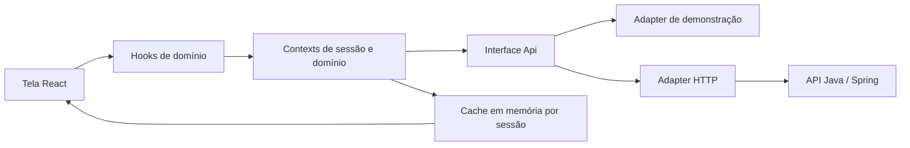

# Context API e integração com Java

A aplicação usa Context API para compartilhar sessão, operações de dados e avisos. As telas consomem hooks de domínio; o adapter HTTP concentra endpoints, cookies, CSRF, paginação e multipart. O backend Java continua responsável por persistência, autenticação, permissões e regras de negócio.

## Caminho dos dados



`AppProvider`, montado em `frontend/src/main.tsx`, compõe os providers:

| Provider | Responsabilidade |
|---|---|
| `ApiProvider` | Injeta um adapter que implementa `Api`. Permite substituir o transporte sem alterar telas. |
| `AuthProvider` | Restaura sessão, faz login/cadastro/logout, recuperação e trata expiração por HTTP 401. |
| `QueryProvider` | Mantém uma instância de cache por sessão e compartilha consultas. |
| `CasesProvider` | Executa alterações de chamados e invalida chamados, indicadores e avisos. |
| `NoticesProvider` | Marca avisos como lidos e invalida somente notificações. |
| `AddressesProvider` | Encapsula consulta de CEP e geocodificação através do adapter injetado. |
| `FeedbackProvider` | Exibe mensagens e oferece `runAction` para ações com confirmação ou erro por aviso. |

Os contexts globais ficam em `frontend/src/app/contexts/`; os de chamados, avisos e endereços ficam no diretório `context/` de cada funcionalidade. Definição do contexto, provider e hook de consumo têm arquivos próprios. `frontend/src/app/providers/AppProvider.tsx` concentra a composição e a injeção do adapter. `app/context.tsx` mantém uma fachada de exportações; as telas importam os hooks diretamente de seus módulos de domínio. O cache fica em `frontend/src/app/data/query-cache.ts`.

Os arquivos, as responsabilidades de cada camada e as regras de dependência estão descritos em [ARQUITETURA_FRONTEND.md](ARQUITETURA_FRONTEND.md).

## Hooks disponíveis

| Hook | Uso |
|---|---|
| `useAuth()` | `user`, `ready`, `sessionError`, `login`, `signup`, `logout`, `recover`, `retrySession`. |
| `useCases(scope, filters?)` | Lista pública, do cidadão (`mine`) ou da Sabesp (`staff`). |
| `useCase(id, scope)` | Detalhe separado por ID e escopo. Sem ID, a consulta fica desabilitada. |
| `useCaseTypes()` | Catálogo de tipos de problema. |
| `useCaseActions()` | `save`, `cancel`, `transition`, `publish`, `schedule`, `link`, `comment`. |
| `useNotices()` | Consulta avisos e oferece `markRead`. |
| `useIndicators(filters?)` | Indicadores para a Prefeitura. |
| `useProfileActions()` | Atualiza perfil e propaga o usuário retornado pelo Java. |
| `useAddressActions()` | Consulta CEP e geocodificação sob demanda. |
| `useFeedback()` | `notify` e `runAction`. |

Consultas retornam `{ data, loading, error, failure, retry }`. `failure` preserva `status` e `fields` de `ApiError`; formulários podem apresentar os erros de campo do backend. As ações retornam uma `Promise` com a resposta da API ou lançam `ApiError`. `runAction` captura a falha, apresenta a mensagem e retorna `false`; em sucesso, retorna `true`.

```tsx
import { useCases } from '@/features/cases/hooks/useCases';
import { useCaseActions } from '@/features/cases/context/useCaseActions';
import { useFeedback } from '@/app/contexts/feedback/useFeedback';

function MinhaLista() {
  const { data, loading, error, retry } = useCases('mine');
  const { cancel } = useCaseActions();
  const { runAction } = useFeedback();

  async function cancelar(id: string) {
    const ok = await runAction(() => cancel(id), 'Chamado cancelado.');
    if (ok) {
      // Feche o diálogo. Lista e detalhe são atualizados pelo CasesProvider.
    }
  }
  // Renderize os estados e use os dados retornados, sem importar api nas telas.
}
```

Para criação ou edição que precisa do objeto retornado, use `await save(input, id?)` com `try/catch`, como em `features/report/hooks/useReportForm.ts`. O envio continua usando `FormData` no adapter HTTP, incluindo arquivos; o contexto não os serializa para JSON. A validação de preenchimento fica em `features/report/lib/validateReportDraft.ts`; arquivos e prévias são administrados por `useReportPhotos`. As regras definitivas permanecem no Java.

## Atualização e isolamento

- Consultas iguais compartilham a requisição em andamento e resultados recentes. Filtros são normalizados; escopos `public`, `mine` e `staff` têm chaves diferentes.
- Uma consulta reutiliza resultados por até 30 segundos ao montar novamente. Depois desse intervalo, refaz a consulta. Não há atualização periódica nem sincronização em tempo real entre computadores.
- Criar, editar, cancelar, alterar status, publicar, agendar, vincular e comentar invalidam chamados, indicadores e avisos. Consultas ativas são refeitas; as inativas aguardam a próxima montagem.
- Marcar aviso como lido invalida somente notificações. Editar perfil atualiza a sessão e invalida chamados. O catálogo não é recarregado a cada alteração.
- Login, cadastro, logout e expiração substituem o cache por uma instância nova. Uma resposta antiga não consegue preencher o cache da próxima sessão.
- Respostas iniciadas antes de uma invalidação não sobrescrevem o resultado novo. Um 401 atrasado de uma sessão anterior não encerra a sessão atual.
- Consultas privadas aguardam a restauração da sessão e só são habilitadas para o perfil correspondente. Essas verificações organizam a interface; o Java deve autorizar todas as requisições.
- Filtros de navegação permanecem na URL; abertura de painéis, campos e arquivos do formulário continuam como estado local da tela.

Não são guardados dados de negócio, senha ou token em `localStorage`. O cache é temporário. O modo de demonstração também usa somente memória e continua identificado visualmente.

## Conectar a API Java

1. Formalize os DTOs e endpoints em [CONTRATO_API_PROPOSTO.md](CONTRATO_API_PROPOSTO.md), comparando com `frontend/src/contracts/index.ts`.
2. Crie `frontend/.env.local` com:

   ```dotenv
   VITE_DATA_MODE=api
   VITE_API_BASE_URL=/api/v1
   ```

3. Inicie o Java em `http://127.0.0.1:8080`. O proxy de desenvolvimento em `frontend/vite.config.ts` encaminha `/api` para esse endereço; ajuste o destino se necessário.
4. Reinicie o Vite depois de alterar as variáveis. Teste restauração de sessão, login e uma consulta antes das alterações.
5. Adapte o serviço correspondente em `services/http/*.service.ts` se os endpoints ou DTOs acordados mudarem. O cliente em `services/http/client.ts` concentra transporte, cookies, CSRF, erros e paginação. A entrada `services/http-api.ts` compõe esses serviços em uma única interface `Api`. Em produção, configure `/api/v1` no mesmo domínio ou alinhe CORS, cookies e CSRF com o Java se usar outra origem.

O adapter atual usa `credentials: 'include'`, cookie de sessão gerenciado pelo servidor e cabeçalho `X-XSRF-TOKEN` quando há cookie `XSRF-TOKEN`. A proposta de autenticação precisa ser alinhada com quem implementar o Spring. Um 401 em uma operação autenticada limpa a sessão e as rotas protegidas levam ao acesso; um 403 apresenta a recusa sem encerrar a conta.

Também é possível injetar outro adapter tipado em testes ou numa integração específica:

```tsx
<AppProvider service={meuAdapterJava}>
  <App />
</AppProvider>
```

`createHttpApi({ baseUrl, fetch, csrfToken })` permite configurar o transporte sem trocar a interface dos contexts. As três opções são opcionais; o adapter padrão usa as variáveis públicas de ambiente e o navegador. `createMockApi()` cria uma demonstração isolada, com estado próprio, para testes ou apresentações. Uma instância não compartilha sessão nem alterações com outra.

As chaves de consulta e as etiquetas de invalidação ficam em `app/data/queryKeys.ts`. Para acrescentar uma operação real: defina os tipos em `contracts/`, implemente o endpoint no serviço HTTP, ofereça a ação no context de domínio e consuma essa ação no hook da funcionalidade. A página e os componentes apresentam o estado retornado pelo hook.

## Validação local

Dentro de `frontend`:

```powershell
npm.cmd test
npm.cmd run test:e2e
npm.cmd run check:architecture
npm.cmd run format:check
npm.cmd run build
```

Os testes do cache usam o executor nativo do Node 22 com remoção experimental de tipos. Os testes de integração usam Playwright, Microsoft Edge instalado e um Vite separado na porta 5174 em modo `api`, com respostas HTTP controladas. Não dependem de um backend Java disponível e não comprovam uma integração real com ele. A prévia normal na porta 5173 continua independente.

Referências: [Context API](https://react.dev/reference/react/createContext), [assinatura do cache com useSyncExternalStore](https://react.dev/reference/react/useSyncExternalStore).
