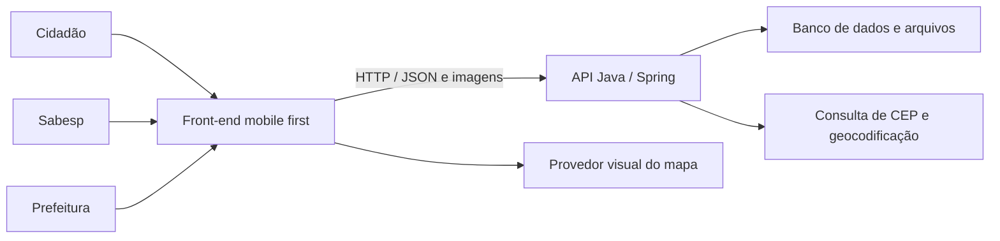

# Saneamento Santos — plano do front-end

Consolidado em 28/10/2026. Nome provisório: **Saneamento Santos**.

Este documento registra as decisões das 22 perguntas do grill e organiza a implementação. A etapa atual é de planejamento; a confirmação final do entendimento precede a implementação das telas.

## 1. Objetivo e recorte da entrega

Construir um sistema web **mobile first** para registrar e acompanhar problemas de esgoto em Santos, com três experiências: cidadão, Sabesp e Prefeitura.

O cidadão informa o problema; a Sabesp faz a triagem e atualiza o atendimento; a Prefeitura acompanha os dados e aplica filtros. O mapa é a entrada principal de consulta, acompanhado de uma alternativa em lista.

O [enunciado acadêmico](<../Exemplos/Captura de tela 2026-10-27 150317.png>) exige Java Web com Spring. A entrega indicada é **16/11/2026 às 13h**, com fechamento de envios às 23h59. Planejar a conclusão antes das 13h.

A participação das instituições será inicialmente na **avaliação e nos testes**. Usar ocorrências fictícias realistas, identificadas como dados de teste. A adoção operacional será uma etapa posterior, a definir com os participantes.

## 2. Divisão entre front-end e Java

| Front-end: React + TypeScript + Vite | Backend: Java + Spring |
|---|---|
| Telas, navegação e adaptação aos tamanhos de tela | Todos os endpoints e operações de CRUD |
| Exibição e interação visual com o mapa usando Leaflet | Persistência de usuários, chamados, imagens e histórico |
| Formulários, máscaras, prévias e mensagens de validação | Validação definitiva de dados, permissões e regras de negócio |
| Chamadas HTTP em uma camada central de serviços | Autenticação, sessões e definição do perfil de cada conta |
| Apresentação das ações disponíveis ao perfil | Autorização de cada leitura e alteração |
| Exibição dos dados, indicadores e notificações retornados | Transições de status, publicação, vínculos e cálculo de indicadores |
| Seleção visual do ponto e envio das coordenadas confirmadas | Consulta de CEP, geocodificação e validação da área atendida |
| Estados de carregamento, erro, vazio e sessão expirada | Upload, armazenamento e autorização de acesso às imagens |

O navegador não será a fonte de verdade dos chamados. Não haverá um banco de negócio em `localStorage`, CRUD definitivo em JavaScript ou regras de atendimento executadas somente na interface. As verificações do formulário servem para orientar o preenchimento; o Java revalida todas as operações.



Haverá duas configurações de desenvolvimento: respostas simuladas para demonstrar as telas e conexão com a API Java. A simulação usa cenários preparados e não substitui a implementação Java. Componentes de tela utilizam a mesma interface de serviços nas duas configurações.

O documento [CONTRATO_API_PROPOSTO.md](CONTRATO_API_PROPOSTO.md) é a proposta concreta para alinhar com o responsável pelo backend. Ele não descreve endpoints já implementados.

## 3. Experiências e telas

### Consulta pública e cidadão

| Tela | Conteúdo e ações |
|---|---|
| Mapa / lista | Pontos publicados, busca, filtros, legenda de status e seleção de chamado |
| Detalhe público | Tipo, endereço do problema, fotos e descrição aprovadas, status, previsão e atualizações públicas |
| Cadastro / acesso | Nome, e-mail e senha; telefone opcional; acesso à recuperação de senha |
| Registrar problema | Formulário em três etapas: local, problema e revisão |
| Confirmação | Protocolo do sistema, indicação de que aguarda validação e acesso ao registro |
| Meus chamados | Registros do cidadão, inclusive os privados, cancelados e vinculados a outro atendimento |
| Meu chamado | Histórico, motivo de encerramento/vínculo e edição/cancelamento quando permitido |
| Notificações | Avisos de mudanças no atendimento, publicação, agendamento e vínculo |
| Perfil | Dados cadastrais e saída da conta |

Navegação mobile proposta: **Mapa, Meus chamados, Registrar, Avisos e Perfil**. A ação de registrar será a mais destacada. O visitante pode consultar o mapa; ao iniciar uma ação que exige conta, é direcionado ao acesso e depois retorna à intenção original.

O formulário de registro terá:

1. **Local:** CEP, logradouro, bairro, cidade/UF, número ou indicação de sem número, referência e marcador ajustável.
2. **Problema:** tipo, descrição, data/hora observada e de uma a três fotos; câmera ou galeria, prévia e remoção antes do envio.
3. **Revisão:** conferir endereço, ponto, descrição, data/hora e anexos antes de enviar.

O endereço é o **local da ocorrência**, não necessariamente a residência do autor. A data/hora observada é diferente da criação do registro, gerada pelo servidor.

### Sabesp

| Tela | Conteúdo e ações |
|---|---|
| Fila de chamados | Recebidos, em análise, agendados e em atendimento; busca e filtros |
| Detalhe operacional | Dados do problema, contato do autor quando necessário, fotos e histórico |
| Triagem | Iniciar análise, aprovar/rejeitar publicação, justificar encerramento ou vincular duplicata |
| Atendimento | Alterar status, registrar janela de visita, escrever atualização pública e observação interna |
| Resolução | Descrever publicamente a solução e anexar foto final opcional |

As ações podem ser apresentadas no detalhe, em seções ou diálogos, sem criar uma página para cada botão. Manter a atualização pública e a observação interna claramente separadas.

### Prefeitura

| Tela | Conteúdo e ações |
|---|---|
| Visão geral | Indicadores dos atendimentos publicados, com definições explícitas |
| Mapa / listagem | Filtros por bairro, período, tipo e status |
| Detalhe | Informações e histórico públicos do chamado |

A Prefeitura acompanha os dados públicos e os indicadores de gestão. Dados pessoais dos autores e observações internas da Sabesp não fazem parte dessa resposta de consulta.

## 4. Regras de atendimento acordadas

### Publicação e status são decisões distintas

O envio cria um registro **Recebido**, ainda privado. O cidadão o acompanha imediatamente em sua área. A Sabesp começa a análise e decide se o conteúdo pode aparecer publicamente.

A aprovação de publicação confirma que o relato pode ser exibido; ela não equivale à conclusão do diagnóstico técnico.

Sequência principal do atendimento:

**Recebido → Em análise → Visita agendada → Em atendimento → Resolvido**

Saídas alternativas: **Vinculado a outro chamado**, **Encerrado sem atendimento** e **Cancelado**. Encerramentos e vínculos precisam de justificativa.

Regras adicionais:

- O cidadão pode editar e cancelar somente enquanto o registro estiver em **Recebido**.
- A Sabesp decide publicação, vínculo, agendamento e andamento do atendimento.
- Chamados sem agendamento mostram **“Sem previsão informada”**.
- A previsão é uma data e janela de horário informada manualmente pela Sabesp, não um prazo calculado pelo front-end.
- A resolução exige uma descrição pública da solução; a foto final é opcional.
- Se o problema voltar após resolvido, criar outro chamado com vínculo de **reincidência** ao anterior.
- A primeira versão terá notificações dentro do sistema.

### Duplicatas

O cidadão pode enviar o registro mesmo que exista outro nas proximidades. A Sabesp determina se é o mesmo problema; proximidade sozinha não confirma duplicidade.

Quando o vínculo é feito:

1. O envio do cidadão permanece em seu histórico e conserva o próprio protocolo.
2. Ele recebe aviso de vínculo com um atendimento existente.
3. A interface indica o protocolo e o status real do atendimento principal.
4. O acompanhamento do atendimento principal fica acessível por uma apresentação adequada às permissões do cidadão.
5. Os indicadores de problemas não contam o relato vinculado como outro atendimento.

Um vínculo de duplicidade aponta para o mesmo problema ainda ativo. Uma ocorrência posterior à resolução é uma reincidência e representa outro atendimento.

### Visibilidade

| Informação | Visitante | Autor do registro | Sabesp | Prefeitura |
|---|---|---|---|---|
| Conteúdo aprovado e publicado | Sim | Sim | Sim | Sim |
| Registro ainda privado | Não | Próprio | Sim | Não |
| Nome e contato do autor | Não | Próprios | Quando necessário ao atendimento | Não |
| Atualização pública publicada | Sim | Sim | Sim | Sim |
| Observação interna | Não | Não | Sim | Não |

O Java deve entregar respostas com somente os campos autorizados. Ocultar um campo na tela não autoriza enviá-lo ao navegador de outro perfil.

## 5. Direção visual e comportamento mobile

As referências são [mapa e lista](<../Exemplos/unnamed.webp>), [detalhe](<../Exemplos/unnamed (1).webp>) e [perfil](<../Exemplos/unnamed (2).webp>).

Aplicar os padrões observados: mapa com busca sobreposta, painel inferior branco com topo arredondado, cartões com resumos, etiquetas legíveis e navegação inferior consistente. O botão central destacado será “Registrar problema”.

Tokens iniciais propostos, sujeitos à verificação visual:

| Uso | Direção |
|---|---|
| Cor principal | Verde petróleo, referência inicial `#0E5B5B` |
| Apoio e destaques | Azul, referência inicial `#2563EB` |
| Fundo | Cinza muito claro `#F4F7F8` e superfícies brancas |
| Texto principal | Escuro `#14272E` |
| Tipografia | Família de sistema para começar, com hierarquia clara |
| Formas | Cartões com aproximadamente 16 px de raio; painel inferior mais arredondado |

Os status terão texto e ícone além da cor. Verificar contraste antes de fechar os tokens.

Requisitos de interação:

- Projetar primeiro para celulares; depois adaptar tablet e desktop.
- No desktop, aproveitar duas colunas para mapa e lista/detalhe.
- Oferecer uma alternativa em lista para consultar o mesmo conjunto de resultados.
- O painel inferior deve expandir por botão e teclado; arrastar pode ser um complemento.
- Ações de toque com área confortável, referência mínima de 44 × 44 px.
- Campos legíveis, foco visível, rótulos persistentes e mensagens junto ao campo.
- Considerar teclado aberto, áreas seguras do celular e altura dinâmica da tela.
- Preservar filtros, posição do mapa e contexto ao voltar de um detalhe.
- Centralizar na localização do usuário somente por ação explícita; abrir inicialmente em Santos.
- Não esconder a atribuição do provedor do mapa atrás do painel ou da navegação.

## 6. Localização e dependências externas

O fluxo será **CEP → endereço → sugestão de coordenadas → confirmação/ajuste do ponto**.

O ViaCEP retorna dados de endereço, sem latitude/longitude em seu exemplo documentado. A geocodificação será uma integração separada, coordenada pelo backend Java. Se a consulta de CEP ou geocodificação falhar, permitir preenchimento manual e marcação assistida, com validação pelo Java.

Leaflet cuida da apresentação e das interações do mapa. O provedor das imagens do mapa e o serviço de geocodificação serão configuráveis e precisam ser escolhidos no alinhamento técnico. Não pressupor capacidade ilimitada dos serviços públicos de mapas. Se forem utilizados tiles públicos do OpenStreetMap, seguir sua política, manter atribuição visível e não implementar download em massa/offline.

## 7. Organização proposta do front-end

Estrutura a criar somente na implementação:

```text
frontend/
  src/
    app/                 # inicialização, rotas e layouts dos perfis
    components/          # botões, campos, cartões, etiquetas e diálogos
    features/
      auth/
      mapa/
      chamados/
      atendimento/
      prefeitura/
      notificacoes/
      perfil/
    services/            # cliente HTTP e serviços por recurso
    contracts/           # tipos de dados trocados com a API Java
    mocks/               # cenários fictícios e respostas de demonstração
    styles/              # tokens e estilos compartilhados
```

Configuração proposta: `VITE_API_BASE_URL` para a API e um modo explícito de demonstração. Rotas e recursos visuais podem ser separados por perfil; componentes e contratos continuam compartilhados.

Na implementação, sessão, consultas e alterações são gerenciadas por Context API e hooks de domínio. A estrutura dos providers, o cache por sessão e os passos de conexão com Java estão em [FLUXO_DADOS_FRONTEND.md](FLUXO_DADOS_FRONTEND.md).

As contas institucionais serão previamente cadastradas no Java. O cadastro público cria apenas cidadãos. O perfil vem da sessão autenticada; o seletor de perfis serve somente à demonstração.

## 8. Ordem de implementação e entregas

Datas abaixo são uma proposta de marcos até o prazo acadêmico. A disponibilidade semanal não foi informada; os marcos devem ser ajustados pela capacidade real e pela disponibilidade da API Java.

| Período proposto | Entrega verificável |
|---|---|
| 28–29/10 | Confirmar plano, alinhar contrato com o backend e fechar os principais desenhos de tela |
| 30/10–04/11 | Base visual, navegação, mapa/lista, detalhe, acesso, registro e meus chamados com dados simulados |
| 05–08/11 | Área Sabesp, triagem, vínculo de duplicatas, atendimento e área Prefeitura |
| 09–12/11 | Integrar o front-end aos endpoints Java disponíveis e corrigir incompatibilidades |
| 13–15/11 | Avaliação com participantes, verificação mobile, acessibilidade e ajustes prioritários |
| 16/11 antes das 13h | Entrega acadêmica e roteiro de demonstração |

Priorizar o fluxo entre os três perfis antes de refinamentos adicionais. A janela de integração depende do trabalho paralelo no backend; o front-end pode avançar com o contrato e os cenários simulados.

Sequência recomendada para disponibilização da API: acesso e consultas → criação e imagens → triagem e alterações → indicadores e notificações.

## 9. Critérios de aceite e validação

### Demonstração das telas

- Visitante consulta somente chamados aprovados, no mapa e na lista.
- Cidadão preenche local, problema, data/hora e imagens, revisa e recebe confirmação.
- Registro recebido aparece na área do autor, aguardando validação.
- Perfil Sabesp demonstra triagem, publicação, agendamento, comentário público e observação interna.
- Duplicata preserva o envio e indica o atendimento principal e seu status real.
- Prefeitura acompanha dados públicos e filtros coerentes com os indicadores.
- Estados de erro, espera, vazio e expiração de sessão estão desenhados e navegáveis.

### Integração com Java

- O chamado criado persiste no Java e reaparece após recarregar a página.
- O Java bloqueia alterações de outro cidadão e operações incompatíveis com o perfil/status.
- O cidadão perde a edição quando a análise começa; o front-end trata essa resposta sem perder a mensagem ao usuário.
- Atualizações da Sabesp aparecem no acompanhamento e nos avisos do autor.
- Fotos privadas e observações internas não são retornadas em consultas públicas ou da Prefeitura.
- Recorrência após resolução cria outro atendimento; duplicata ativa não duplica a contagem.
- Datas, filtros, paginação, imagens e mensagens de validação funcionam com as respostas reais.

### Verificação visual e funcional

Inspecionar larguras de 320, 360, 390, 430, 768 e 1280 px, zoom de 200%, teclado aberto e navegação por teclado. Conferir ausência de rolagem horizontal indevida, conteúdo coberto pela navegação, campos cortados e controles de mapa inacessíveis.

Na implementação, automatizar os fluxos que verificam comportamentos relevantes: envio/erros do formulário, apresentação por perfil e jornada de atendimento. Os testes definitivos de regras e autorização pertencem ao backend Java.

## 10. Evoluções sugeridas

Após concluir o escopo acordado: seguir um chamado de outra pessoa, notificações por e-mail/push, instalação como PWA, mapa de calor, indicadores mais avançados e avaliação do atendimento. Integrações com sistemas oficiais dependem da etapa de adoção e não foram exigidas para esta primeira avaliação.

## 11. Registro das decisões do grill

| Pergunta | Decisão |
|---|---|
| Q1 | Web responsivo com prioridade mobile first; PWA pode vir depois. |
| Q2 | Priorizar o fluxo completo entre os três perfis; horas semanais não informadas. |
| Q3 | Mapa público; conta para registrar e acessar a área pessoal. |
| Q4 | CEP, endereço e confirmação ajustável do marcador. |
| Q5 | Participação real das instituições, detalhada na Q7. |
| Q6 | Previsão informada manualmente pela Sabesp. |
| Q7 | Instituições participam da avaliação e dos testes; adoção posterior a definir. |
| Q8 | Validação antes da publicação; autor acompanha o envio imediatamente. |
| Q9 | Conteúdo aprovado, local, status e previsão públicos; dados pessoais restritos. |
| Q10 | Nome, e-mail e senha; telefone opcional e recuperação de acesso. |
| Q11 | Uma foto obrigatória e até três por chamado, com prévia e remoção. |
| Q12 | Permitir envio; avisar e vincular se a triagem identificar o mesmo problema em andamento. |
| Q13 | Testes começam com ocorrências fictícias realistas em Santos. |
| Q14 | Sabesp faz a triagem e decide publicação, encerramento e vínculo. |
| Q15 | Fluxo de atendimento definido; publicação controlada separadamente. |
| Q16 | Autor edita/cancela somente enquanto estiver Recebido. |
| Q17 | Notificações dentro do sistema na primeira versão. |
| Q18 | Atualização pública e observação interna separadas; interna restrita à Sabesp. |
| Q19 | Sabesp resolve com descrição pública e foto opcional; reincidência gera novo chamado vinculado. |
| Q20 | Contas institucionais previamente cadastradas; cadastro público somente de cidadão. |
| Q21 | Nome provisório: Saneamento Santos. |
| Q22 | CRUD, backend e regras em Java; front-end visual separado permitido. |

## 12. Fontes consultadas

- [React: criação de aplicação com ferramentas como Vite](https://react.dev/learn/build-a-react-app-from-scratch).
- [Leaflet: mapas interativos e recursos mobile](https://leafletjs.com/).
- [ViaCEP: formato da consulta e retorno de endereço](https://viacep.com.br/).
- [OpenAPI: descrição compartilhada de APIs HTTP](https://spec.openapis.org/oas/latest.html).
- [OpenStreetMap: política de uso dos tiles públicos](https://operations.osmfoundation.org/policies/tiles/).
